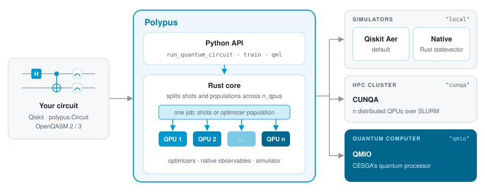
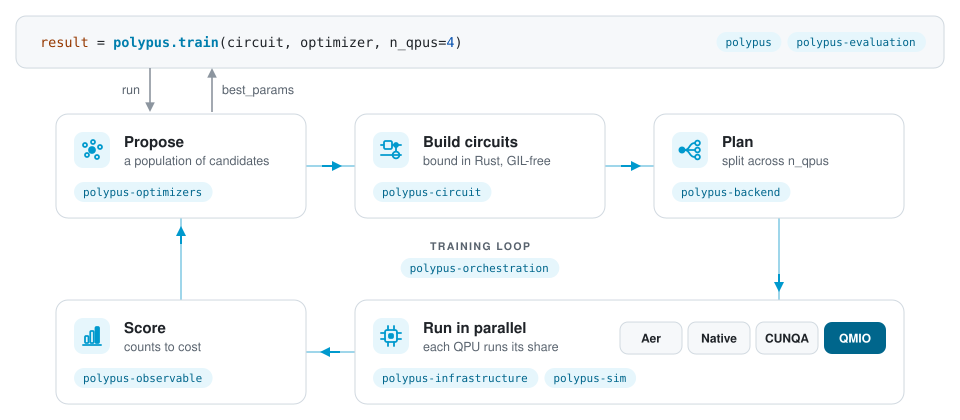

<p align="center">
  
</p>

<h3 align="center">Run and train quantum circuits across many QPUs, simulated or real, with one API.</h3>

<p align="center">
  <a href="https://pypi.org/project/polypus-quantum/"></a>
  <a href="https://crates.io/crates/polypus"></a>
  <a href="https://pypi.org/project/polypus-quantum/"></a>
  <a href="https://github.com/Bahia-Software/polypus/actions/workflows/ci.yml"></a>
  <a href="https://bahia-software.github.io/polypus/"></a>
  <a href="https://github.com/Bahia-Software/polypus/blob/main/LICENSE"></a>
  <a href="https://doi.org/10.5281/zenodo.22913065"></a>
</p>

<p align="center">
  <b>Rust core</b> · <b>Python API</b> · runs on local simulators, on HPC clusters through <a href="https://github.com/CESGA-Quantum-Spain/cunqa">CUNQA</a>, and on the QMIO quantum computer at CESGA
</p>

<p align="center">
  <a href="https://bahia-software.github.io/polypus/">Documentation</a> ·
  <a href="#installation">Install</a> ·
  <a href="#quickstart">Quickstart</a> ·
  <a href="https://github.com/Bahia-Software/polypus/tree/main/docs/guide">User guide</a> ·
  <a href="https://github.com/Bahia-Software/polypus-tutorials">Tutorials</a> ·
  <a href="https://github.com/Bahia-Software/polypus/blob/main/CHANGELOG.md">Changelog</a> ·
  <a href="#citing-polypus">Cite</a>
</p>

---

Polypus splits shots and optimizer populations across `n_qpus` and runs them on a local simulator, on CESGA's CUNQA distributed QPUs or on the QMIO quantum processor. Changing the target means changing one argument, not the algorithm code.

<p align="center">
  
</p>

## Why Polypus

- **From laptop to cluster to real QPU, unchanged.** `infrastructure="local"`, `"cunqa"` or `"qmio"` is the only line that moves.
- **Parallel by design.** Shots and whole optimizer populations are planned in Rust and spread across QPUs; results come back per QPU and merged.
- **Fast where it matters.** Circuits are built, bound and simulated in Rust; parameter binding runs without the GIL, about 3x faster than Qiskit's `assign_parameters`.
- **Safe and reproducible.** Every simulated run reports its seed for an exact replay, and a circuit too large for the memory budget is refused before allocation instead of being OOM-killed.

## Features

<table>
<tr>
<td width="50%" valign="top">
<b>Multi-QPU execution</b><br>
Run on Qiskit Aer, the native Rust simulator, CUNQA or QMIO, with counts per QPU and merged.
<a href="https://github.com/Bahia-Software/polypus/blob/main/docs/guide/running.md">Running circuits</a>
</td>
<td width="50%" valign="top">
<b>Variational training</b><br>
DE (classic, SHADE, L-SHADE), PSO, QNG, CMA-ES, Adam, SPSA and Rotosolve behind one <code>train()</code> call, or any ask/tell optimizer via <code>polypus.External</code>.
<a href="https://github.com/Bahia-Software/polypus/blob/main/docs/guide/training.md">Variational training</a>
</td>
</tr>
<tr>
<td valign="top">
<b>Quantum machine learning</b><br>
Train Qiskit circuits with <code>qml.train</code>, or native <code>qml.Model</code>s with exact gradients, minibatches and a PyTorch layer.
<a href="https://github.com/Bahia-Software/polypus/blob/main/docs/guide/qml.md">Quantum machine learning</a>
</td>
<td valign="top">
<b>Rust circuit engine</b><br>
<code>polypus.Circuit</code> composes, draws (text or SVG) and reads and writes OpenQASM 2 and 3, and exports QIR.
<a href="https://github.com/Bahia-Software/polypus/blob/main/docs/guide/circuits.md">Circuits and interchange</a>
</td>
</tr>
<tr>
<td valign="top">
<b>Native cost observables</b><br>
QUBO and Ising costs are evaluated in Rust, without a Python call per bitstring.
<a href="https://github.com/Bahia-Software/polypus/blob/main/docs/guide/training.md">Cost functions</a>
</td>
<td valign="top">
<b>Shor's algorithm</b><br>
<code>polypus.shor.factor</code> factors an integer end to end on any backend, with Beauregard's order-finding circuit built in Rust.
<a href="https://github.com/Bahia-Software/polypus/blob/main/docs/guide/circuits.md#factoring-with-shor">Factoring with Shor</a>
</td>
</tr>
</table>

## Installation

```bash
pip install polypus-quantum
```

The package imports as `polypus` (the name `polypus` on PyPI belongs to an unrelated project). Wheels are published for CPython 3.10 to 3.13 on Linux (x86_64, aarch64), macOS on Apple Silicon and Windows (x86_64); elsewhere pip builds the source distribution, which needs Rust 1.85 or newer.

| To use | Install |
|---|---|
| Local simulators (Aer and native) | `pip install polypus-quantum` |
| A native QML model as a PyTorch layer (`polypus.torch`) | `pip install "polypus-quantum[torch]"` |
| Optuna, Nevergrad or pycma through `polypus.External` | `pip install "polypus-quantum[optuna]"` (`[nevergrad]`, `[cma]`) |
| CUNQA | Polypus, plus [CUNQA](https://github.com/CESGA-Quantum-Spain/cunqa) `>=2.4,<4` on the cluster. **CUNQA 2.3 is not supported** (it names the `qraise` argument `cores`, not `cores_per_qpu`) |
| QMIO | Polypus built from source with the `qmio` feature: `bash install.sh --qmio` |
| The Rust crates | `cargo add polypus-circuit`, or any crate under [Architecture](#architecture); all but three are pure Rust |

<details>
<summary>Building from source</summary>

```bash
git clone https://github.com/Bahia-Software/polypus.git
cd polypus
bash install.sh            # interactive; --yes takes the defaults, --no-tests skips the test suite
```

Or by hand:

```bash
pip install -r requirements-dev.txt
maturin build --release --out dist
pip install dist/polypus_quantum-*.whl
```

For development, `maturin develop --release` installs both packages in editable mode instead: edits to Python files take effect at once, and only a Rust change needs the command run again.
</details>

`import polypus` does no work and writes nothing; the native simulator calibrates itself once per machine on first use (see [Performance](https://github.com/Bahia-Software/polypus/blob/main/docs/guide/performance.md)).

## Quickstart

**Run a Bell circuit on 4 QPUs**

```python
import polypus

bell = polypus.Circuit(2).h(0).cx(0, 1).measure_all()
result = polypus.run_quantum_circuit(
    bell, shots=1000, infrastructure="local", backend="polypus", n_qpus=4
)

result.counts  # one counts dict per QPU
result.merged_counts  # e.g. {'00': 487, '11': 513}
```

`backend="polypus"` is the native Rust simulator; without it, the run goes to Qiskit Aer, which also takes Qiskit `QuantumCircuit` objects and noise models. To run on a cluster or a real QPU, replace `infrastructure="local", backend="polypus"` with `infrastructure="cunqa"` or `"qmio"`.

**Draw it**

```python
print(bell)
```

```text
     ┌───┐       ┌─┐
q0: ─┤ H ├───■───┤M├─────
     └───┘   │   └╥┘
           ┌─┴─┐  ║  ┌─┐
q1: ───────┤ X ├──╫──┤M├─
           └───┘  ║  └╥┘
                  ║   ║
c2: ══════════════╩═══╩══
                  0   1
```

No plotting library is involved: `bell.draw("svg")` returns an SVG document, which Jupyter displays by itself.

<details>
<summary><b>Train a QAOA circuit for MaxCut</b></summary>

```python
import polypus

edges = [(0, 1), (1, 2), (2, 3), (3, 0)]
gamma, beta = polypus.Param(0), polypus.Param(1)

qaoa = polypus.Circuit(4)
for q in range(4):
    qaoa.h(q)
for i, j in edges:
    qaoa.rzz(i, j, gamma)
for q in range(4):
    qaoa.rx(q, beta)
qaoa.measure_all()

# Cut size as a QUBO, evaluated natively. Optimizers maximise.
cut = polypus.Qubo(
    4,
    linear=[(q, 2.0) for q in range(4)],
    quadratic=[(i, j, -2.0) for i, j in edges],
)

result = polypus.train(
    qaoa,
    polypus.DE(generations=100, population_size=50, seed=42),
    shots=1024,
    n_qpus=1,
    dimensions=2,
    expectation_function=cut,
    infrastructure="local",
    backend="polypus",
    nodes=1,
    cores_per_qpu=1,
    id="maxcut",
)
result.best_params, result.best_fitness
```

Swap `polypus.DE` for any other optimizer; [Choosing an optimizer](https://github.com/Bahia-Software/polypus/blob/main/docs/guide/training.md#choosing-an-optimizer) compares them on MaxCut at the same evaluation budget.
</details>

<details>
<summary><b>Factor 15 with Shor's algorithm</b></summary>

```python
from polypus.shor import factor

result = factor(15, a=7, infrastructure="local", backend="polypus", seed=1)
result.factors, result.method, result.order  # ((3, 5), 'quantum', 4)
result.peak_share, result.uniform_peak_share  # (0.734375, 0.03515625)
```

`peak_share` is the share of shots on the order's peaks: compare it with the 3/4 of an ideal circuit and with `uniform_peak_share`, what random outcomes would give. See [Factoring with Shor](https://github.com/Bahia-Software/polypus/blob/main/docs/guide/circuits.md#factoring-with-shor).
</details>

The [tutorials](https://github.com/Bahia-Software/polypus-tutorials), in English and Spanish, go from a first circuit to a native classifier; [`examples/`](https://github.com/Bahia-Software/polypus/tree/main/examples) has complete scripts.

## Backends

| `infrastructure` | `backend` | Runs on | Seeded | Notes |
|---|---|---|---|---|
| `"local"` | `"aer"` (default) | Qiskit Aer | Yes | Full Qiskit circuit support |
| `"local"` | `"polypus"` | Native Rust statevector | Yes | Terminal measurements only ([ADR 0001](https://github.com/Bahia-Software/polypus/blob/main/docs/adr/0001-terminal-measurements.md)) |
| `"cunqa"` | | CUNQA QPUs over SLURM | Yes | `nodes`, `cores_per_qpu` and `walltime` (`HH:MM:SS`) size the allocation |
| `"qmio"` | | QMIO quantum processor | No | Pure-Rust ZeroMQ client; build with the `qmio` feature. The endpoint comes from `ZMQ_SERVER` or `options={"endpoint": ...}` |

`polypus.backend_compatibility(qc)` lists, for each backend (Aer, native, CUNQA, QMIO), why it would reject a circuit, without running it; `resources=True` also checks the native qubit ceiling and memory budget. Third-party backends plug in through a Rust trait or a Python worker; see [Writing a backend](https://github.com/Bahia-Software/polypus/blob/main/docs/backends.md).

## User guide

| Topic | Covers |
|---|---|
| [Running circuits](https://github.com/Bahia-Software/polypus/blob/main/docs/guide/running.md) | `RunResult`, multi-QPU runs, seeds, choosing a local backend, errors, troubleshooting |
| [Variational training](https://github.com/Bahia-Software/polypus/blob/main/docs/guide/training.md) | `train` parameters, `TrainResult`, cost functions, DE (classic, SHADE, L-SHADE), PSO, QNG, CMA-ES, Adam, SPSA, Rotosolve and external optimizers; starting points, final re-evaluation, callbacks, and a benchmark for choosing an optimizer |
| [Quantum machine learning](https://github.com/Bahia-Software/polypus/blob/main/docs/guide/qml.md) | `qml.train` with Qiskit circuits, labels, `SampleCost` and `qml.predict`; native models with `qml.Model`: layers, readout, losses, `fit`, prediction, saving |
| [Circuits and interchange](https://github.com/Bahia-Software/polypus/blob/main/docs/guide/circuits.md) | `polypus.Circuit`, the Rust builder, angle expressions, composing, templates (QFT, Shor's order finding), factoring with Shor, drawing, OpenQASM 2 and 3, QIR |
| [Memory budget](https://github.com/Bahia-Software/polypus/blob/main/docs/guide/memory.md) | `POLYPUS_MEM_BUDGET`, cgroup detection, `InsufficientMemoryError` |
| [Performance](https://github.com/Bahia-Software/polypus/blob/main/docs/guide/performance.md) | Batched simulation, GIL-free binding, gate-parallel auto-calibration |

The [documentation site](https://bahia-software.github.io/polypus/) hosts the [user and developer guides](https://bahia-software.github.io/polypus/) and the changelog; the Rust API of every crate is under [`rust/`](https://bahia-software.github.io/polypus/rust/polypus/).

## Architecture

Polypus is a Cargo workspace of 14 crates, all published on [crates.io](https://crates.io/crates/polypus); only the three PyO3 crates link against Python, the rest can be used from any Rust project.

<p align="center">
  
</p>

<details>
<summary>All crates</summary>

| Crate | Role |
|---|---|
| [`polypus`](https://github.com/Bahia-Software/polypus/tree/main/crates/polypus) | Python extension, exception hierarchy, re-exports |
| [`polypus-circuit`](https://github.com/Bahia-Software/polypus/tree/main/crates/polypus-circuit) | Circuit representation, composition, templates (QFT, Shor's order finding), text and SVG drawings, OpenQASM 2 and 3, QIR |
| [`polypus-sim`](https://github.com/Bahia-Software/polypus/tree/main/crates/polypus-sim) | Statevector simulator |
| [`polypus-optimizers`](https://github.com/Bahia-Software/polypus/tree/main/crates/polypus-optimizers) | DE (classic, SHADE, L-SHADE), PSO, QNG, CMA-ES, Adam (or momentum), SPSA and Rotosolve, and a bridge to ask/tell optimizers |
| [`polypus-observable`](https://github.com/Bahia-Software/polypus/tree/main/crates/polypus-observable) | QUBO and Ising cost observables |
| [`polypus-qml`](https://github.com/Bahia-Software/polypus/tree/main/crates/polypus-qml) | Quantum machine learning models: datasets, layers, readout and losses |
| [`polypus-physics`](https://github.com/Bahia-Software/polypus/tree/main/crates/polypus-physics) | Monte Carlo transport, Pauli-sum Hamiltonians (Jordan–Wigner and parity mappings, tapering, exact diagonalization) and molecular Hamiltonians (H₂, STO-3G) |
| [`polypus-backend`](https://github.com/Bahia-Software/polypus/tree/main/crates/polypus-backend) | The `QuantumBackend` trait that backends implement and the `Planner` that sizes circuit waves |
| [`polypus-backend-conformance`](https://github.com/Bahia-Software/polypus/tree/main/crates/polypus-backend-conformance) | Conformance tests for backends |
| [`polypus-subprocess-backend`](https://github.com/Bahia-Software/polypus/tree/main/crates/polypus-subprocess-backend) | Bridge for backends written in Python |
| [`polypus-infrastructure`](https://github.com/Bahia-Software/polypus/tree/main/crates/polypus-infrastructure) | Built-in backends (Aer, CUNQA, QMIO, native) |
| [`polypus-orchestration`](https://github.com/Bahia-Software/polypus/tree/main/crates/polypus-orchestration) | `Flow`, `Scheduler` and `Resources`; optimizer dispatch |
| [`polypus-evaluation`](https://github.com/Bahia-Software/polypus/tree/main/crates/polypus-evaluation) | Oracles and objective assembly |
| [`polypus-logger`](https://github.com/Bahia-Software/polypus/tree/main/crates/polypus-logger) | Shared log sink |
| [`polypus_python`](https://github.com/Bahia-Software/polypus/tree/main/python/polypus_python) | Python-side backend glue, bundled in the wheel |

</details>

Design notes: [contracts](https://github.com/Bahia-Software/polypus/blob/main/docs/CONTRACTS.md), [engineering rules](https://github.com/Bahia-Software/polypus/blob/main/docs/ENGINEERING.md), [architecture decisions](https://github.com/Bahia-Software/polypus/tree/main/docs/adr). To contribute, see [CONTRIBUTING](https://github.com/Bahia-Software/polypus/blob/main/docs/CONTRIBUTING.md). Release history: [CHANGELOG](https://github.com/Bahia-Software/polypus/blob/main/CHANGELOG.md). To report a vulnerability, see [SECURITY](https://github.com/Bahia-Software/polypus/blob/main/SECURITY.md); community rules are in the [Code of Conduct](https://github.com/Bahia-Software/polypus/blob/main/CODE_OF_CONDUCT.md).

## Engineering

- **Released and versioned.** Every release ships to PyPI, crates.io and Zenodo; public Rust APIs are checked with `cargo-semver-checks`, and breaking changes come with upgrade notes in the [CHANGELOG](https://github.com/Bahia-Software/polypus/blob/main/CHANGELOG.md).
- **Tested beyond unit tests.** CI runs clippy with warnings as errors, the MSRV build, Miri on the simulator kernels, fuzzing of the OpenQASM 2 and 3 importers, a `cargo-deny` licence and advisory audit, and wheel builds on Linux, macOS and Windows; mutation testing runs weekly.
- **Specified.** Cross-layer behaviour is written down as [contracts](https://github.com/Bahia-Software/polypus/blob/main/docs/CONTRACTS.md), each backed by tests, and design choices as [architecture decisions](https://github.com/Bahia-Software/polypus/tree/main/docs/adr). New backends are checked by the `polypus-backend-conformance` suite.

## Citing Polypus

If Polypus is useful in your research, please cite it:

```bibtex
@software{polypus,
  author  = {Fernández Prada, Diego Beltrán and Sóñora Pombo, Víctor and Figueiras Gómez, Sergio and Boubeta Martínez, Miguel and Pérez González, Kevin and Sendón Caamaño, Uxía and {Galicia Supercomputing Center (CESGA)}},
  title   = {{Polypus: A Distributed Quantum Computing Library}},
  year    = {2026},
  url     = {https://github.com/Bahia-Software/polypus},
  doi     = {10.5281/zenodo.22913065},
  version = {0.8.0}
}
```

The same metadata is in [`CITATION.cff`](https://github.com/Bahia-Software/polypus/blob/main/CITATION.cff), which GitHub shows as *Cite this repository*.

## License

Polypus is developed by Bahía Software with the Galicia Supercomputing Center (CESGA) and is licensed under the [European Union Public Licence 1.2](https://github.com/Bahia-Software/polypus/blob/main/LICENSE). Bundled third-party data (IAEA EPDL photon interaction files) is not covered by the EUPL; see [NOTICE](https://github.com/Bahia-Software/polypus/blob/main/NOTICE).
